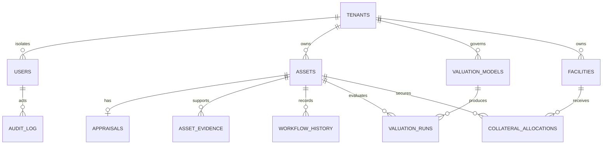

# CollMan enterprise execution — 30 October 2026

Release decision: **NO-GO / BLOCKED**. This is a tested integration candidate, not bank production certification. No production migration or environment swap is performed by this change.

## Actual baseline and integration

- Repository `elanghaqeem-hash/CollMan`, public; main baseline `67dd476ff4e1f322b8894afa33d55ba9acfa33da`.
- Existing Vercel project `collman`, ID `prj_XfJOcY7dzut4OdM1Tx2cbyfpZflW`, team `team_Y6DNKOu4wHEjmSax8LeZ1B7J`, region Singapore.
- Production alias `https://collman-lemon.vercel.app` inspected at deployment `dpl_GqWcGcSoEoMAJwyvwTWr76KdikWi`, SHA `4bca94a1371c7cf709586ad6c2af05276579da90`.
- Existing PRs #4 (universal collateral), #5 (cache fix), #6 (DB mapping audit), #7 (BRD evidence) are integrated on a separate feature branch. Their history is retained; none is blindly merged to production-tracked main.
- Preview and Production metadata reference distinct PostgreSQL backing resources. Historical resource names were reversed. Metadata separation does not prove contents, ownership, migration checksums or restore readiness. Do not swap URLs based on labels.
- Source attachments are processed outside the public repository. No raw source documents, borrower rows, workbook prices or bank internal OCR text are committed.

## Implemented changes

1. Integrate the 16-category / 74-type collateral catalog, category-specific forms, evidence review and cache fixes; resolve merge conflicts without losing either capability.
2. Move final evidence checks into the locked approval transaction and require independent review/approval actors. Preserve immutable audit and history.
3. Introduce versioned model registry, independent Reviewer validation and separate Approver sign-off, suspension, immutable model definitions and immutable indication snapshots with SHA256 input lineage.
4. Implement sourced indication formulas in `src/valuation-engine.js`; inputs, prices and bank calibration are never seeded. Scope is category + region + effective dates; stale/future/missing sources and insufficient comparables fail closed.
5. Add facilities, independently approved many-to-many allocations, bank accepted ceiling, coverage/LTV, and independently approved release. Release pending remains allocated. A PostgreSQL trigger enforces the asset ceiling in addition to transactional API checks.
6. Add Model Registry and Facilities & Allocation views and a valuation studio in asset detail, with persisted forms, role-aware actions, CSV exports and desktop/mobile browser coverage.
7. Replace the default legacy deploy command with an existing-project Vercel target guard. No Cloudflare/Turso deployment is selected by `npm run deploy`.

## Architecture and ERD

The existing static JavaScript UI calls the single Node.js Vercel Function through same-origin `/api/*`. That function checks the session and tenant before calling parameterized PostgreSQL statements. Mutations and audit writes commit together. Pool size remains 2 per instance. Migrations are explicit administrative operations, never request-time or build-time changes.

Composite `(tenant_id,id)` foreign keys protect every new cross-object relation. Application roles cannot delete audit, workflow, evidence, valuation snapshots or allocation history through the API. Database-owner privileges must be separated operationally; SQL triggers do not protect against a malicious schema owner.

## Formula contract

| Method | Indication before currency conversion |
|---|---|
| ADJUSTED_COMPARABLE | Subject units × weighted mean of `(price / comparable units) × (1 + adjustment% / 100)` |
| PROPERTY_COST | Land area × land unit price + sum of building area × depreciated replacement unit cost |
| COST | Replacement cost × (1 − physical loss) × (1 − functional loss) × (1 − economic loss) |
| INCOME_CAP | Annual net income / capitalization rate |
| DCF | Sum of annual cash flows discounted by period + discounted terminal value |
| QUOTED | Units × quoted price / explicit quote divisor (including bond per-100 basis or NAV) |
| NOMINAL | Confirmed blocked amount, no more than confirmed balance |
| GOLD | Grams × tested purity × sourced fine gold price per gram |
| RECEIVABLE | Sum of `(outstanding − exclusions) × supported recovery estimate` |
| SPECIALIST | Dated, referenced specialist valuation; no invented specialist model |
| RECONCILIATION | Weighted mean of distinct referenced approach indications and documented reliability weights |
| GUARANTEE | Confirmed limit × sourced FX; market, liquidation and bank asset values remain null |

FX must have its own dated reference. Property cost supports an explicitly supplied unit rounding increment, matching the rounding order of selected source equations. Inputs and loss rates are assumptions needing independent review, not automatic market evidence.

Liquidation is a separate explicitly entered estimate with mandatory basis. Bank accepted indication is a separate amount with a policy reference and may not exceed liquidation. Regulatory value stays **null / NOT_CONFIGURED** pending a bank-approved, effective-dated regulatory rule set. No regulatory haircut or legal conclusion is inferred. Coverage uses the separately reviewed bank acceptance stored on the manual appraisal, not the unapproved model indication.

Every model run has `approved_market_value: null` and `automatic_final_valuation: false`. Even a model with registry status VALIDATED cannot publish final appraisal automatically. This change intentionally does not connect indication snapshots to automatic credit decisions. Manual appraisal remains a separate human workflow.

## Validation scope and defects

- Synthetic unit/API coverage exercises all existing categories through registration, appraisal, independent review and approval. Additional coverage tests governed model transitions, scope/source validation, formula outputs, guarantee separation, bank ceilings, excess allocation denial and independent release.
- Backtest metrics: MAPE, MdAPE and signed percentage bias. With at least 20 observations, deterministic 1,000-replicate percentile bootstrap reports descriptive iid 95% intervals for mean error metrics. This assumes representative independent observations; it is not a confidence interval on any individual asset valuation. With fewer observations the interval is null, not invented.
- Validation observations must match the model's category and region. An independent human records sample sufficiency/limitations; separate human sign-off changes registry status. No real bank model is pre-approved by synthetic tests.
- Two private selected workbook equation cases reconcile exactly. Source workbooks contain cached formula errors. This proves the selected equations and rounding only, not end-to-end workbook validity. Source correction, full recalculation and independent appraisal-methodology acceptance remain release blockers.
- Local integration uses PostgreSQL WASM (PGlite). Real PostgreSQL service CI, lock/concurrency tests and restore rehearsal are distinct evidence and must be checked at the final commit.
- Browser test covers real UI → HTTP → isolated PostgreSQL WASM → reload/response on desktop and 390px mobile. This is not authenticated bank production UAT.

## Migration and rollback

Applied only to disposable test databases during implementation:

| Version | Purpose |
|---|---|
| 0001–0004 | Existing schema, tenant integrity, immutable history, financial checks |
| 0005 | Existing universal collateral extension |
| 0006 | Existing asset evidence review |
| 0007 | Governed model registry and immutable indication snapshots |
| 0008 | Facilities, bank acceptance and allocation/release guard |

Before touching managed Preview or Production: verify the actual database fingerprint, take an encrypted provider backup, record SHA256 and migration checksums, restore to an isolated approved target, compare counts/content/integrity, and obtain controlled change approval. Existing data/users/tenants are not reinitialized. Apply all versioned SQL files using the direct connection in an authorized administrative session. `db:verify` checks checksums and mandatory protections.

The CI restore rehearsal dumps synthetic data, restores to a second disposable database, verifies schema and compares every table's count and SHA256 content fingerprint. It does not establish recoverability of either managed environment.

Rollback is code rollback to the recorded baseline after compatibility review, while retaining additive tables/history. Do not run DROP/DELETE or restore over the active production database as a routine rollback. Backups are restored to an isolated target first. Exact production backup and rollback RPO/RTO still require owner approval and rehearsal.

## Explicit open release gates

| Gate | Status / required evidence |
|---|---|
| Managed Production and Preview DB contents and checksums | BLOCKED: no verified live SQL administrative session in this run |
| Production encrypted backup and restore | BLOCKED: no provider restore artifact or approved isolated target verified |
| SSO/MFA, identity federation and branch ABAC | NOT IMPLEMENTED: existing tenant-scoped RBAC is retained; branch codes do not enforce branch access |
| Bank approval/delegated authority matrix | PARTIAL: fixed six-role workflow plus stricter SoD; configurable authority limits/delegation outstanding |
| Vault encryption, malware scanning, retention/legal hold | NOT IMPLEMENTED: metadata only; no raw document upload |
| Licensed market/GIS/legal connectors | BLOCKED: provider agreements, credentials and authoritative data not configured |
| Model validation for every activated category and region | BLOCKED: real realization samples, independent model owners and acceptance absent |
| Complete business UAT, security assessment and sign-off | BLOCKED: no authenticated live six-role bank UAT or process/control signatures |
| Business lifecycle beyond appraisal and allocation release | PARTIAL: assignment/SLA, periodic monitoring, insurance, revaluation version workflow, substitution, recovery and AYDA remain outstanding |
| Bank-specific regulatory recognition and effective dates | NOT IMPLEMENTED: regulatory outputs remain null |
| Bank reporting templates and signed memorandum PDFs | PARTIAL: existing on-screen reports/CSV/print only |
| SIEM, tested DR and operational hypercare | NOT VERIFIED / not activated |
| Commercial/operational hosting and data controls | NOT VERIFIED: bank owner/platform assessment required |

Production release is not attempted while these gates remain open. A READY preview or passing CI is not a production go decision.
